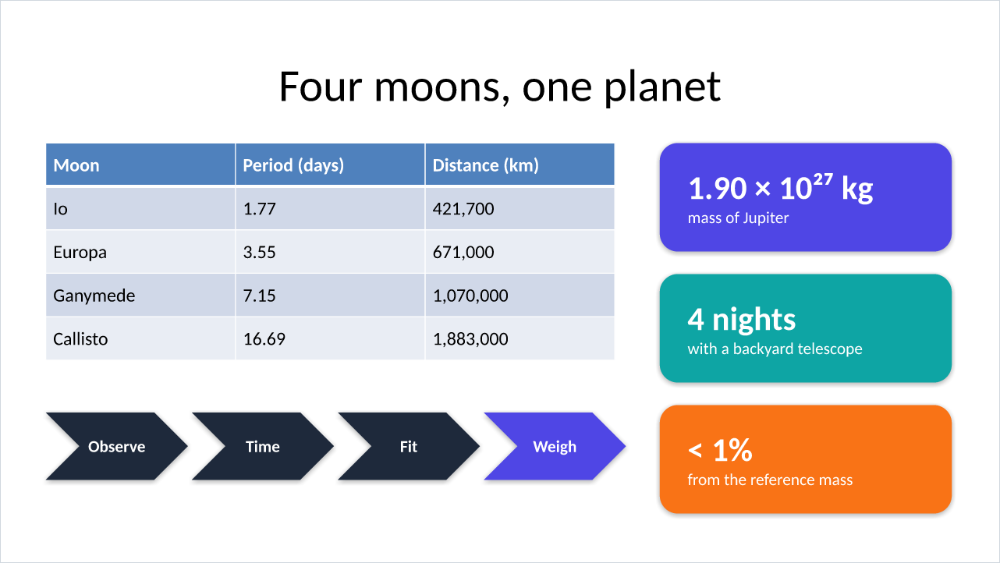

<div align="center">


# oxoffice

**Word and PowerPoint files in pure Rust: read, write, edit, compare and render `.docx` and `.pptx`,
from Rust, the command line or Python.**

[](https://github.com/oxoffice-dev/oxoffice/actions/workflows/ci.yml)
[](https://github.com/oxoffice-dev/oxoffice/releases/latest)
[](LICENSE)
[](#-install)
[](#-python)

</div>

|  |  |
|:---:|:---:|
| 📝 A redline of two versions of a report, in reviewer colours | 📊 A slide built and rendered from code |

<p align="center"><sub>Both pictures come straight out of oxoffice: no Word, no PowerPoint, no LibreOffice.</sub></p>

## ✨ Why oxoffice

- 🦀 **One engine, three doors**: a Rust API, an `oxoffice` command for everything that makes sense in a
  shell, and an `oxoffice` Python package that covers the whole API for when the shell is not enough.
- 📄 **Word and PowerPoint as equals**, with spreadsheets on the [roadmap](ROADMAP.md).
- ✍️ **Edits that keep the file intact**: unmodelled XML is carried over verbatim, child order follows the
  schema, and text changes keep their formatting.
- 🔍 **Real review tools**: list, accept and reject tracked changes, compare two versions into a redline,
  work with comments.
- 🖨️ **Rendering without an office suite**: PDF, PNG, HTML and Markdown, with bundled fonts so the output is
  the same on every machine.
- 🚫 **Nothing to install around it**: no Office, no LibreOffice, no conversion service, no network.

## 🚀 Quick start

### 📦 Install

| Channel | Command |
| --- | --- |
| 🐚 Installer, Linux and macOS | `curl -fsSL https://github.com/oxoffice-dev/oxoffice/releases/latest/download/install.sh \| sh` |
| 🪟 Installer, Windows | `powershell -ExecutionPolicy Bypass -c "irm https://github.com/oxoffice-dev/oxoffice/releases/latest/download/install.ps1 \| iex"` |
| 🐍 PyPI | `pip install oxoffice`, `uv add oxoffice` or `uv tool install oxoffice` |
| 🟢 conda | `pixi global install -c https://prefix.dev/hadim/oxoffice -c conda-forge oxoffice` |
| 📦 GitHub release | binaries, wheels and checksums on the [releases page](https://github.com/oxoffice-dev/oxoffice/releases) |
| 🦀 Rust | `oxoffice-docx = { git = "https://github.com/oxoffice-dev/oxoffice", tag = "v0.1.0" }` |

The installers and the Python channels all give you the `oxoffice` command, and the Python channels also give
you the `oxoffice` package. Every release ships `SHA256SUMS`, an SBOM and a signed build provenance: check any
file with `gh attestation verify <file> --repo oxoffice-dev/oxoffice`. Details, pinning and verification:
[docs/INSTALL.md](docs/INSTALL.md).

### Command line

```bash
oxoffice docx inspect report.docx
oxoffice docx text report.docx
oxoffice docx convert report.docx --to pdf
oxoffice docx replace report.docx -p "{{client}}" -v "Acme" -o out.docx
oxoffice docx diff v1.docx v2.docx

oxoffice pptx outline deck.pptx
oxoffice pptx render deck.pptx -o slides/
oxoffice pptx convert deck.pptx --to md
```

### Python

```python
from oxoffice.docx import Document
from oxoffice.pptx import Presentation

doc = Document()
doc.add_heading("Quarterly report", level=1)
doc.add_paragraph("Revenue grew by 12 %.")
doc.save("report.docx")

deck = Presentation("deck.pptx")
for slide in deck.slides:
    for shape in slide.shapes:
        if shape.has_text_frame:
            print(shape.text_frame.text)
```

The Python API starts from the names of python-docx and python-pptx, so most code reads the same, but it is not bound to them: it differs where that makes it safer or simpler, for example `save` refuses to overwrite the file a document was opened from.

### Rust

```toml
[dependencies]
oxoffice-docx = { git = "https://github.com/oxoffice-dev/oxoffice", tag = "v0.1.0" }
```

```rust
use oxoffice_docx::Document;

let mut doc = Document::new();
doc.add_paragraph("Hello from Rust");
doc.save("hello.docx")?;
```

## 🧰 What it does

A tour by family rather than a full list: each command's `--help`, the Python type stubs and the examples of
[oxoffice-skills](https://github.com/oxoffice-dev/oxoffice-skills) go into the details. ✅ works, ⚠️ works with
known gaps (`oxoffice limitations docx` or `pptx` lists each one with its workaround, or the note says why),
❌ not yet, — does not apply.

### 📝 Word

| Family | Read | Edit | Create | Notes |
| --- | :---: | :---: | :---: | --- |
| Text, runs, find and replace | ✅ | ✅ | ✅ | counted replacements that keep formatting and refuse text they cannot reach |
| Styles | ✅ | ✅ | ✅ | |
| Lists and numbering | ✅ | ⚠️ | ✅ | a list numbered through its style cannot be restarted |
| Tables | ✅ | ✅ | ✅ | merges, borders, shading, nested tables |
| Sections, headers and footers | ✅ | ⚠️ | ✅ | the document-wide header or footer setter reaches the last section only |
| Footnotes and endnotes | ✅ | ⚠️ | ✅ | removing a paragraph leaves its notes behind |
| Comments and replies | ✅ | ✅ | ✅ | anchored on a piece of text, moved, resolved, dated |
| Tracked changes | ✅ | ✅ | ⚠️ | accept and reject by id, author or date; a redline from two versions, while writing your own edits as tracked changes is on the [roadmap](ROADMAP.md) |
| Fields and tables of contents | ✅ | ✅ | ✅ | page numbers, page references, dates, sequences, cross-references |
| Content controls and forms | ✅ | ⚠️ | ✅ | fill, validate, reset and protect; export to fillable PDF fields is coming |
| Pictures and watermarks | ✅ | ✅ | ✅ | a replaced picture keeps its frame |
| Charts | ✅ | ⚠️ | ✅ | an existing chart's legend can change, not its data yet |
| Hyperlinks and bookmarks | ✅ | ✅ | ✅ | |
| Mail merge | ✅ | ✅ | ✅ | from Rust and Python |
| Bibliography | ⚠️ | ⚠️ | ⚠️ | sources, citations and the bibliography from Rust only for now; more on the [roadmap](ROADMAP.md) |
| Conversions | ✅ | — | ✅ | from Markdown and HTML; to PDF and PDF/A, HTML, Markdown, ODT, RTF, EPUB and page images |
| Embedded fonts | ✅ | ✅ | ✅ | you state that the font's licence allows it |
| Signatures | ✅ | — | ✅ | sign and verify, no certificate chain trust |
| Encryption | ⚠️ | — | ⚠️ | open and save with a password, from Rust only for now |

### 📊 PowerPoint

| Family | Read | Edit | Create | Notes |
| --- | :---: | :---: | :---: | --- |
| Slides | ✅ | ⚠️ | ✅ | add, duplicate, import, move, hide, sections; a slide with comments cannot be duplicated yet |
| Shapes and groups | ✅ | ✅ | ✅ | every shape walked, groups included; align, distribute, z-order, glued connectors |
| Text | ✅ | ✅ | ✅ | replacements that keep run formatting, bullets and numbering |
| Text fit | ✅ | ✅ | — | reports what overflows with oxoffice's own line breaks, shrinks text to fit |
| Tables | ✅ | ⚠️ | ✅ | some tables merged by LibreOffice or Google cannot be split or narrowed |
| Charts | ✅ | ✅ | ✅ | new data keeps the series formatting |
| Pictures | ✅ | ✅ | ✅ | a replaced picture keeps its frame and crop |
| Speaker notes | ✅ | ✅ | ✅ | notes pages and handouts as PDF |
| Comments and replies | ✅ | ✅ | ✅ | modern comments, on a slide or a shape |
| Themes, masters and layouts | ✅ | ✅ | ✅ | theme colours and fonts, a theme taken from another deck |
| Merging decks | — | ⚠️ | — | slides imported onto a layout of the deck or with their own formatting, which refuses slides with notes for now |
| Rendering and export | — | — | ✅ | PDF and PDF/A, PNG and JPEG slides, HTML, Markdown |
| Embedded fonts | ✅ | ✅ | ✅ | you state that the font's licence allows it |
| Signatures | ✅ | — | ✅ | sign and verify, no certificate chain trust |
| Encryption | ⚠️ | — | ⚠️ | open and save with a password, from Rust only for now |

## 🗺️ Status

oxoffice is young: 0.x, and the API can still move. It starts from rdocx 0.17.0 and rpptx 0.15.0, which
already cover a lot of Word and PowerPoint. What comes next is in the [roadmap](ROADMAP.md): a new test
suite, edits that cost only the element they touch, fillable PDF forms, bibliographies, authoring tracked
changes and comments, and spreadsheets.

## 🤝 Contributing

Read [CLAUDE.md](CLAUDE.md) and [docs/DEVELOPMENT.md](docs/DEVELOPMENT.md). Non-trivial changes start with
a short spec in [specs/](specs/). Commits and pull request titles follow
[conventional commits](https://www.conventionalcommits.org).

## 🙏 Credits

oxoffice is a friendly fork of [rdocx](https://github.com/tensorbee/rdocx) by Atul Sharma, who built the
Word and PowerPoint engine it starts from. See [NOTICE](NOTICE).

## 📄 License

[MIT](LICENSE).
