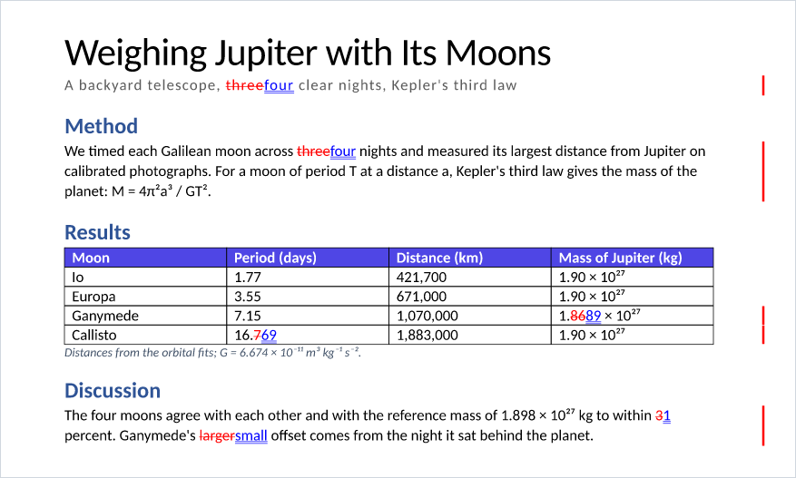

<div align="center">


# oxoffice

**Word and PowerPoint files in pure Rust: read, write, edit, compare and render `.docx` and `.pptx`,
from Rust, the command line or Python.**

[](https://github.com/oxoffice-dev/oxoffice/actions/workflows/ci.yml)
[](https://github.com/oxoffice-dev/oxoffice/releases/latest)
[](LICENSE)
[](#-install)
[](#-python)

</div>

|  |  |
|:---:|:---:|
| 📝 A redline of two versions of a report, in reviewer colours | 📊 A slide built and rendered from code |

<p align="center"><sub>Both pictures come straight out of oxoffice: no Word, no PowerPoint, no LibreOffice.</sub></p>

## ✨ Why oxoffice

- 🦀 **One engine, three doors**: a Rust API, an `oxoffice` command for everything that makes sense in a
  shell, and an `oxoffice` Python package that covers the whole API for when the shell is not enough.
- 📄 **Word and PowerPoint as equals**, with spreadsheets on the [roadmap](ROADMAP.md).
- ✍️ **Edits that keep the file intact**: unmodelled XML is carried over verbatim, child order follows the
  schema, and text changes keep their formatting.
- 🔍 **Real review tools**: list, accept and reject tracked changes, compare two versions into a redline,
  work with comments.
- 🖨️ **Rendering without an office suite**: PDF, PNG, HTML and Markdown, with bundled fonts so the output is
  the same on every machine.
- 🚫 **Nothing to install around it**: no Office, no LibreOffice, no conversion service, no network.

## 🚀 Quick start

### Command line

```bash
oxoffice docx inspect report.docx
oxoffice docx text report.docx
oxoffice docx convert report.docx --to pdf
oxoffice docx replace report.docx -p "{{client}}" -v "Acme" -o out.docx
oxoffice docx diff v1.docx v2.docx

oxoffice pptx outline deck.pptx
oxoffice pptx render deck.pptx -o slides/
oxoffice pptx convert deck.pptx --to md
```

### Python

```python
from oxoffice.docx import Document
from oxoffice.pptx import Presentation

doc = Document()
doc.add_heading("Quarterly report", level=1)
doc.add_paragraph("Revenue grew by 12 %.")
doc.save("report.docx")

deck = Presentation("deck.pptx")
for slide in deck.slides:
    for shape in slide.shapes:
        if shape.has_text_frame:
            print(shape.text_frame.text)
```

The Python API follows python-docx and python-pptx, so most code moves over by changing the import.

### Rust

```toml
[dependencies]
oxoffice-docx = { git = "https://github.com/oxoffice-dev/oxoffice" }
```

```rust
use oxoffice_docx::Document;

let mut doc = Document::new();
doc.add_paragraph("Hello from Rust");
doc.save("hello.docx")?;
```

## 📦 Install

Every [release](https://github.com/oxoffice-dev/oxoffice/releases) carries the `oxoffice` binary for Linux,
macOS and Windows, the Python wheels and a `SHA256SUMS` file. PyPI, crates.io and conda-forge come later.

## 🗺️ Status

oxoffice is young: 0.x, and the API can still move. It starts from rdocx 0.17.0 and rpptx 0.15.0, which
already cover a lot of Word and PowerPoint. What comes next is in the [roadmap](ROADMAP.md): a new test
suite, edits that cost only the element they touch, fillable PDF forms, bibliographies, authoring tracked
changes and comments, and spreadsheets.

## 🤝 Contributing

Read [CLAUDE.md](CLAUDE.md) and [docs/DEVELOPMENT.md](docs/DEVELOPMENT.md). Non-trivial changes start with
a short spec in [specs/](specs/). Commits and pull request titles follow
[conventional commits](https://www.conventionalcommits.org).

## 🙏 Credits

oxoffice is a friendly fork of [rdocx](https://github.com/tensorbee/rdocx) by Atul Sharma, who built the
Word and PowerPoint engine it starts from. See [NOTICE](NOTICE).

## 📄 License

[MIT](LICENSE).
